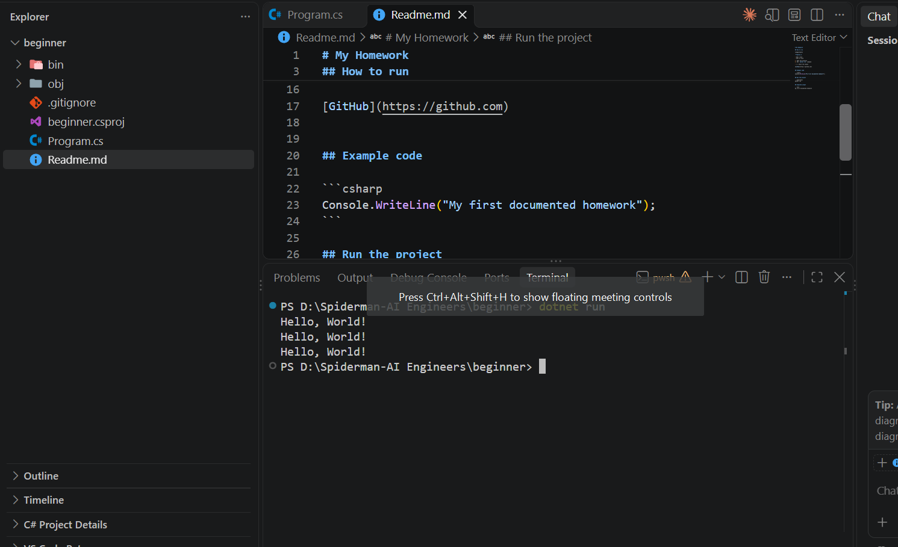

# My Homework

## How to run

**Important**

`Program.cs`

- Add a task
- Add an issue

1. Open the terminal
2. Run `dotnet run` command

- [ ] Check the output

[GitHub](https://github.com)


## Example code

```csharp
Console.WriteLine("My first documented homework");
```

## Run the project

```powershell
dotnet run
```

## Expected output

```text
My first documented homework
```

### Expected Result
